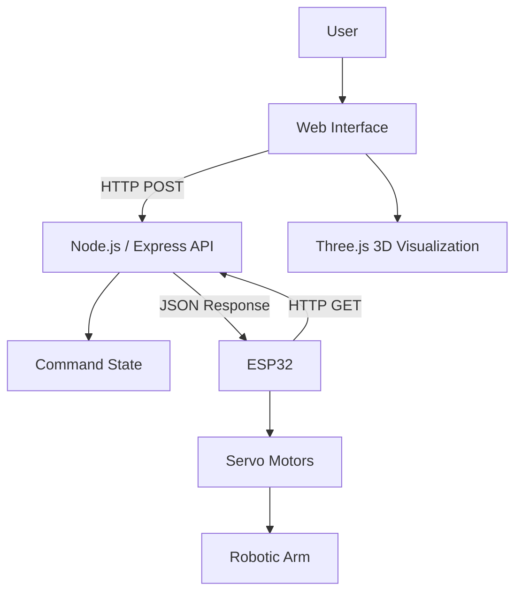

# 🤖 Robotic Arm — Web-Based Control System

<p align="center">
  A robotic arm controlled through a web interface, integrating embedded systems, network communication, backend development, and 3D visualization.
</p>

<p align="center">
  
  
  
  
  
</p>

---

## 📌 Overview

This project consists of a robotic arm controlled remotely through a web-based interface.

The system integrates an **ESP32 microcontroller**, three servo motors, a Node.js backend, and a 3D visualization environment built with Three.js.

Users can independently control the robotic arm's three joints — shoulder, elbow, and wrist — through a web interface. Commands are transmitted to a local server using HTTP requests, allowing the ESP32 to retrieve and execute the requested movements.

The project explores the integration of hardware and software, combining embedded programming, network communication, backend architecture, and 3D modeling into a single application.

## 🎯 Project Goals

- Develop a remotely controlled robotic arm.
- Establish wireless communication between an ESP32 and a local server.
- Implement an HTTP API using Node.js and Express.
- Build a web interface for joint manipulation.
- Create a 3D representation of the robotic arm using Three.js.
- Explore hardware-software integration through a practical engineering project.

## 🏗️ System Architecture

The application is divided into three main components:

| Component | Responsibility | Technologies |
|---|---|---|
| Embedded System | Executes motor commands and communicates over Wi-Fi | ESP32, C++ |
| Backend | Receives, validates, and provides movement commands | Node.js, Express |
| Frontend | Provides controls and 3D visualization | HTML, CSS, JavaScript, Three.js |

### Communication Flow



The frontend sends movement commands to the backend using HTTP POST requests. The ESP32 periodically polls the API through HTTP GET requests and retrieves the latest command values in JSON format.

## 🦾 Robotic Arm

The physical structure consists of three independently controlled joints:

| Joint | Function |
|---|---|
| Shoulder | Rotates the main arm assembly |
| Elbow | Controls forearm articulation |
| Wrist | Rotates the end plate around its longitudinal axis |

Each joint is controlled by an individual servo motor.

The system uses angular commands to determine the desired position of each articulation.

## 🖥️ Web Interface & 3D Visualization

The web application provides an interface for controlling the robotic arm and monitoring the command state.

Features include:

- Individual controls for each joint.
- Real-time 3D preview while adjusting the controls.
- HTTP communication with the backend.
- Server connection status.
- Command submission and position monitoring.
- Interactive 3D camera controls.

The 3D environment was developed using **Three.js**, with a hierarchical joint structure that reproduces the mechanical relationship between the shoulder, elbow, and wrist.

## 🔌 Hardware

Main components:

- ESP32 development board.
- 3 servo motors.
- Robotic arm mechanical structure.
- External power supply for the servos.
- Electrical connections and common ground.

**Note:** The servo motors use an external power supply, while the ESP32 handles control signals and network communication.

## ⚙️ Technologies

### Embedded Systems
- C++
- ESP32
- Wi-Fi communication
- Servo motor control

### Backend Development
- Node.js
- Express.js
- HTTP methods (GET / POST)
- JSON data exchange
- Input validation

### Frontend Development
- HTML5
- CSS3
- JavaScript
- Three.js
- HTTP API integration

## 🚀 Running the Project

### Prerequisites

- Node.js and npm installed.
- ESP32 development environment.
- ESP32 and computer connected to the same local network.
- Servo motors and external power supply properly connected.

### 1. Clone the repository

```bash
git clone https://github.com/P96Z7/ESP32-robotic-arm-HTTP
cd YOUR_PROJECT_FOLDER
```

### 2. Install dependencies

```bash
npm install
```

### 3. Configure the ESP32

Update the Wi-Fi credentials and server address in the firmware:

```cpp
const char* serverUrl = "http://YOUR_SERVER_IP:3000/comando";
```

Make sure the ESP32 and the server are connected to the same network.

### 4. Start the backend

```bash
node server.js
```

The server will start on port `3000`.

### 5. Open the web interface

Access the application through your browser:

```text
http://localhost:3000
```

To access it from another device on the same network, use the server's local IP address:

```text
http://YOUR_SERVER_IP:3000
```

## 📡 API Reference

The backend exposes an endpoint for retrieving and updating the robotic arm's commands.

| Method | Endpoint | Description |
|---|---|---|
| GET | `/comando` | Retrieves the current joint commands |
| POST | `/comando` | Updates the desired joint angles |

### Example POST Request

```json
{
  "angleS": 90,
  "angleE": 180,
  "angleH": 90
}
```

### Example Response

```json
{
  "message": "Comando atualizado",
  "comando": {
    "angleS": 90,
    "angleE": 180,
    "angleH": 90
  }
}
```

The backend validates the received values before updating the command state.

## 📚 Engineering Concepts Explored

Throughout development, this project involved practical applications of:

- Embedded software development.
- Client-server architecture.
- HTTP communication protocols.
- REST API fundamentals.
- JSON serialization and parsing.
- Wi-Fi networking.
- Servo motor control.
- 3D transformations and hierarchical modeling.
- Hardware-software integration.

## 🔮 Future Improvements

Potential extensions include:

- Feedback from physical joint positions.
- Persistent command and telemetry storage.
- Inverse kinematics.
- Improved 3D model calibration.
- Additional robotic joints and end-effectors.
- Remote access beyond the local network.
- Safety mechanisms and movement constraints.

## 👨‍💻 Author

**Pablo Pazini**

Software Engineering Student | Embedded Systems & Software Development

Interested in embedded software, robotics, computer systems, and the integration of hardware and software.

---

<p align="center">
  <i>Exploring the intersection between software engineering and robotics.</i>
</p>
